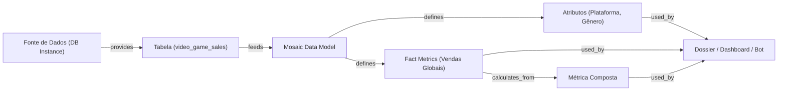

## Context

Ver `proposal.md` para motivação e `specs/mosaic-data-lineage/spec.md` para requisitos.
O usuário requer que o Sankey Diagram no Strategy Dossier exiba um fluxo contínuo de linhagem End-to-End:
`Fonte de Dados (DB Connection)` ──▶ `Tabelas` ──▶ `Modelo Mosaic` ──▶ `Atributos e Métricas` ──▶ `Objetos Dependentes (Dossiers, Reports, Bots/Agentes)`

## Goals / Non-Goals

**Goals:**
- **Estágio 1 (Upstream - Fonte de Dados)**: Extrair nome da conexão/instância de banco (ex: `[DB Instance: postgres_emarinho]`) via `SuperCube.export_sql_view()` e catálogo de `/api/datasources`.
- **Estágio 2 (Tabelas)**: Mapear tabelas físicas e lógicas a partir dos metadados e expressões de atributos e fatos.
- **Estágio 3 (Modelo Mosaic)**: Representar o modelo central que consolida as tabelas.
- **Estágio 4 (Camada Semântica)**: Mapear atributos, métricas de fato e métricas calculadas/compostas com fórmulas e dependências.
- **Estágio 5 (Downstream - Dependentes)**: Mapear objetos que utilizam o modelo analítico via `SuperCube.list_dependents()`, categorizando em Dossiers/Dashboards, Relatórios e Agentes de IA/Bots.
- **Grafo DAG Contínuo**: Conectar os 5 estágios com arestas direcionadas coerentes para que a tabela `Lineage_Sankey` gere um diagrama contínuo de ponta a ponta no Dossier.
- **Multi-formato**: Exportar em JSON, YAML e CSV com todas as entidades e dependências.
- **Publicação SuperCube**: Publicar o cubo `Lineage_Sankey` na pasta `Public Objects > Reports > Data Lineage`.

**Non-Goals:**
- Não fará alteração na arquitetura de schema do Strategy (apenas leitura de modelos e publicação de datasets/cubos em memória).
- Não gerará interface gráfica de visualização de grafos proprietária (UI utiliza o visual Sankey do Dossier da Strategy).
- Não fará reverse-engineering de triggers ou stored procedures internas do banco.

## Decisions

### Decisão 1: Cadeia de 5 Estágios no Grafo DAG para Sankey Fluido

O grafo de linhagem conectará as entidades da seguinte forma:

- **Arestas Encadeadas**:
  1. `datasource` ──▶ `table` (`relationship_type: "provides"`)
  2. `table` ──▶ `data_model` (`relationship_type: "feeds"`)
  3. `data_model` ──▶ `attribute` / `fact_metric` (`relationship_type: "defines"`)
  4. `fact_metric` ──▶ `metric` (`relationship_type: "calculates_from"`)
  5. `attribute` / `fact_metric` / `metric` ──▶ `dependent_object` (`relationship_type: "used_by"`)

### Decisão 2: Descoberta de Fontes de Dados Upstream

- **Método**: Executar `SuperCube(connection, id=model_id).export_sql_view()`.
- **Parsing**: Extrair via regex o padrão `\[DB Instance:\s*([^\]]+)\]`. Se disponível, cruzar com `/api/datasources` para obter ID único da conexão.
- **Nó gerado**: `Node(id=ds_id, name=ds_name, type="datasource", properties={"type": "database_connection"})`.

### Decisão 3: Descoberta de Objetos Dependentes Downstream

- **Método**: Executar `SuperCube(connection, id=model_id).list_dependents()`.
- **Classificação de Tipo**:
  - `subtype == 779` ou `type == 55`: `dossier` (Dossier / Dashboard)
  - `type == 3`: `report` (Relatório)
  - `type == 68`: `bot_agent` (Agente de IA / Bot)
  - `type in (256, 776)`: `cube` (Cubo dependente)
  - Demais: `object`
- **Nó gerado**: `Node(id=dep_id, name=dep_name, type=dep_type, properties={"subtype": dep_subtype})`.

### Decisão 4: Estrutura da Tabela `Lineage_Sankey` e Harmonização de Relacionamentos

Para possibilitar que o usuário use o visual Sankey por níveis no Strategy Dossier e monte grades/planilhas cruzando `source_name --> table_name --> model_name --> object_name --> formula` sem quebras de relacionamentos entre tabelas, a tabela `Lineage_Sankey` conterá caminhos desnormalizados de linhagem com atributos dedicados:
- `source_name`: Apenas a fonte de dados / instância de banco de dados (ex: `postgres_emarinho`).
- `table_name`: Nome da tabela física ou lógica utilizada (ex: `video_game_sales`).
- `model_name`: Nome do modelo analítico Mosaic (ex: `Video Games`).
- `object_name`: Nome do atributo, métrica de fato ou métrica composta (ex: `Platform`, `Global Sales`).
- `object_type`: Tipo do objeto (`attribute`, `fact_metric`, `metric`).
- `formula`: Fórmula da métrica calculada/fato (ou `'N/A'` para atributos).
- `aggregation`: Tipo de agregação da métrica (ex: `Sum`, `Avg` ou `'N/A'`).
- `is_compound`: `'True'` / `'False'` (ou `'N/A'`).
- `dependent_name`: Nome do artefato consumidor downstream (ex: `Torre de Controle - Expo`) ou `(Nenhum)` caso o objeto ainda não possua dependente direto.
- `dependent_type`: Tipo do dependente (`dossier`, `report`, `bot_agent` ou `none`).
- `weight`: Métrica de contagem / peso (numérico = `1`).

*Harmonização entre Tabelas do Cubo e Rastreabilidade de Métricas:*
- Em `Metrics_Catalog`, incluir as colunas `object_name` (correspondendo ao nome da métrica) e `model_name`. No motor analítico do Strategy, atributos com nomes idênticos em tabelas distintas de um mesmo SuperCube são automaticamente associados, permitindo relacionar `Lineage_Sankey` e `Metrics_Catalog` nativamente.
- A presença de `formula` diretamente na tabela `Lineage_Sankey` elimina 100% da dependência de relacionamentos cruzados para grades simples, garantindo performance e zero falhas de visualização.
- **Rastreabilidade de Métricas Calculadas**:
  - Quando `object_type == "metric"`, identificar tabelas upstream inspecionando os nós referenciados pela fórmula (`calculates_from` -> `fact_metric` -> `table`).
  - Associar `formula` ao campo `m_def.formula_text` gerado por tokens / expressão textual.
  - Se métrica não referenciar tabela física direta, associar ao modelo sem quebrar a cadeia.

### Decisão 5: Resolução Bilíngue de Pastas de Destino (Inglês e Português)

O Strategy organiza metadados em pastas cujos nomes variam com a localidade do projeto:
- **Inglês**: `Public Objects > Reports > Data Lineage`
- **Português**: `Objetos Públicos > Relatórios > Data Lineage`

Em `CubePublisher.get_or_create_reports_folder`:
1. Testar caminhos absolutos e relativos tanto para inglês quanto para português:
   - `/{project_name}/Public Objects/Reports`
   - `/{project_name}/Objetos Públicos/Relatórios`
   - `/Public Objects/Reports`, `/Objetos Públicos/Relatórios`
   - `Public Objects/Reports`, `Objetos Públicos/Relatórios`
2. Caso busca direta por path falhe, executar `full_search` para `name="Reports"` e `name="Relatórios"`, verificando se o caminho (`path`) contém `"Public Objects"` ou `"Objetos Públicos"`.
3. Buscar ou criar a subpasta `Data Lineage` dentro da pasta de relatórios identificada.
4. Caso a pasta pai não seja localizada, buscar a pasta raiz de objetos públicos (`full_search(name="Objetos Públicos")` e `full_search(name="Public Objects")`) em vez de falhar com erro de domínio `ERR006`.

## Risks / Trade-offs

- **[Modelos sem dependentes cadastrados]** → *Mitigação*: Se o modelo ainda não tiver dashboards ou relatórios dependentes, o grafo encerra na camada de atributos/métricas sem gerar erros.
- **[Modelos com fontes de dados não-relacionais (ex: arquivos Excel importados)]** → *Mitigação*: Se `export_sql_view()` não contiver `[DB Instance: ...]`, registrar fonte como `In-Memory / File Import` e manter o fluxo com a tabela.
- **[Volume de objetos dependentes]** → *Mitigação*: Usar nós compactados e IDs únicos no dicionário para evitar duplicidade de nós no DAG.
